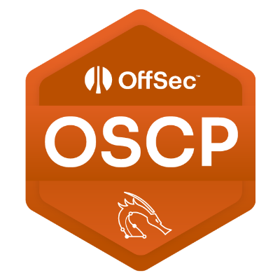
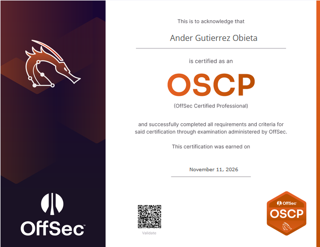

# OSCP y OSCP+: Mi experiencia con el examen de OffSec

`Publicado en noviembre de 2026 por PatxaSec`

Los que me conocéis sabéis que llevo bastante tiempo trabajando en el ámbito del pentesting, especialmente en entornos internos y Active Directory. Durante este tiempo, OSCP era una de esas certificaciones que tenía pendiente y que, tarde o temprano, quería conseguir.

Después de completar el proceso y enfrentarme al examen, quería compartir mi experiencia, algunas de las cosas que me he encontrado y las conclusiones que saco de todo ello.

No pretendo hacer una guía de preparación al uso ni explicar cómo resolver los escenarios del examen. Tampoco voy a entrar en detalles técnicos que puedan comprometer la confidencialidad de la prueba. La idea es hablar de mi experiencia, de los conocimientos que considero importantes y de lo que realmente me ha aportado esta certificación.

Estos son los puntos que voy a tratar:

- Contexto.
- ¿Cómo fue el examen?
- Mi experiencia durante la prueba.
- ¿Qué conocimientos necesitas realmente?
- ¿Cómo me preparé?
- ¿Merece la pena OSCP?
- Conclusiones.

---

# Contexto

OSCP (*Offensive Security Certified Professional*) es una certificación de pentesting ofrecida por Offensive Security. Se trata de una de las certificaciones más conocidas dentro del ámbito de la ciberseguridad ofensiva y, probablemente, una de las referencias habituales cuando hablamos de pentesting práctico.

Su formación abarca diferentes áreas relacionadas con las pruebas de penetración, desde la enumeración inicial de sistemas hasta la explotación de vulnerabilidades, la escalada de privilegios y los ataques contra entornos Active Directory.

Entre los contenidos que se trabajan encontramos:

- Reconocimiento y enumeración de servicios.
- Explotación de servicios y aplicaciones web.
- Búsqueda, análisis y adaptación de exploits.
- Escalada de privilegios en Linux y Windows.
- Ataques contra contraseñas y mecanismos de autenticación.
- Transferencia de archivos y ejecución de payloads.
- Pivoting, túneles y redirecciones de tráfico.
- Enumeración y explotación de Active Directory.
- Movimiento lateral y obtención de privilegios elevados.

Como podéis ver, el temario es bastante amplio y cubre buena parte de las técnicas que podemos encontrarnos durante una auditoría interna o externa.

En mi caso, buena parte de estos conceptos ya formaban parte de mi día a día profesional, especialmente todo lo relacionado con entornos Windows, redes internas y Active Directory.

Precisamente por eso, mi objetivo no era empezar desde cero, sino consolidar conocimientos, trabajar aquellos aspectos que tenía menos practicados y enfrentarme a una certificación que llevaba tiempo queriendo conseguir.

---

# ¿Cómo fue el examen?

El examen de OSCP es una prueba eminentemente práctica. No se trata de responder preguntas teóricas ni de demostrar que conoces de memoria una determinada herramienta. Tienes que enfrentarte a diferentes sistemas, identificar posibles vías de entrada, conseguir acceso y demostrar que eres capaz de escalar privilegios.

En mi convocatoria, el entorno estaba dividido en dos grandes bloques:

- **Máquinas independientes (*standalone*):** escenarios en los que cada sistema debe abordarse de forma individual, desde la enumeración inicial hasta la obtención de privilegios elevados.
- **Active Directory:** un entorno compuesto por varios sistemas relacionados entre sí, en el que debes identificar relaciones de confianza, permisos y posibles vías de movimiento lateral hasta alcanzar el objetivo final.

Aunque ambos bloques comparten muchas de las técnicas habituales de pentesting, la forma de abordarlos es bastante diferente.

En las máquinas independientes, el trabajo consiste principalmente en identificar qué ofrece cada sistema, encontrar una posible vía de explotación y conseguir avanzar hasta obtener acceso administrativo.

En Active Directory, en cambio, cobra mucha más importancia entender el entorno en su conjunto. No basta con comprometer una máquina y dar por terminado el trabajo. Hay que investigar cómo se relacionan los diferentes sistemas, qué usuarios tienen acceso a qué recursos y qué permisos pueden permitir avanzar dentro del dominio.

Y aquí es donde la enumeración adquiere todavía más importancia.

## La supervisión y la documentación

El examen está supervisado (*proctored*), por lo que hay que cumplir con los procedimientos establecidos por Offensive Security durante su realización.

Es una parte más del proceso y conviene tenerla en cuenta antes de empezar para evitar que cuestiones ajenas a la parte técnica puedan distraerte durante la prueba.

Por otro lado, hay algo que considero especialmente importante: **el examen no termina cuando consigues las flags**.

La elaboración del informe forma parte de la evaluación y requiere documentar correctamente las vulnerabilidades identificadas, explicar los pasos realizados y aportar evidencias que permitan reproducir los resultados.

En mi caso, fui documentando los procedimientos a medida que avanzaba. Es algo que recomiendo encarecidamente, porque intentar reconstruir horas de enumeración y explotación una vez terminado el examen puede convertirse en un auténtico problema.

---

# Mi experiencia durante el examen

Esta es probablemente la parte que más me apetecía compartir.

No voy a entrar en nombres de máquinas, direcciones IP, credenciales, flags ni detalles concretos de explotación. Creo que se puede hablar perfectamente de la experiencia sin revelar información del entorno del examen.

Durante la prueba me encontré con escenarios bastante diferentes entre sí. Algunos requerían una enumeración más exhaustiva, mientras que otros dependían de identificar correctamente una configuración insegura o una relación de privilegios que, a primera vista, podía pasar desapercibida.

## Las máquinas independientes

La parte de máquinas independientes me resultó bastante familiar por la dinámica de trabajo.

El proceso era el habitual: enumerar los servicios expuestos, investigar las posibles vías de entrada, conseguir un acceso inicial y, una vez dentro, realizar una enumeración local para identificar oportunidades de escalada de privilegios.

En estos escenarios me encontré con situaciones relacionadas con servicios expuestos, configuraciones de autenticación débiles y mecanismos de escalada de privilegios tanto en Windows como en Linux.

También hubo momentos en los que las primeras opciones que probé no dieron resultado. Y creo que esto es algo importante: no siempre vas a encontrar una vulnerabilidad evidente ni vas a conseguir acceso ejecutando el primer exploit que encuentres.

En ocasiones toca volver atrás, revisar la información recopilada y plantear otras posibilidades.

En mi caso, conseguí completar dos de los tres objetivos independientes. El tercero se quedó pendiente, algo que también forma parte de la experiencia y que demuestra que no siempre vas a conseguir resolver todos los escenarios, por mucho que conozcas las técnicas.

## Active Directory

La parte de Active Directory fue, sin duda, uno de los bloques más interesantes del examen.

Aquí tuve que aplicar conocimientos de enumeración de dominios, autenticación, extracción y reutilización de credenciales, movimiento lateral y análisis de permisos.

A diferencia de una máquina independiente, el objetivo no era simplemente conseguir acceso administrativo a un sistema concreto. Había que entender cómo encajaban las diferentes piezas del entorno y cómo utilizar la información obtenida en una máquina para continuar avanzando hacia las siguientes.

Durante el proceso aparecieron diferentes oportunidades relacionadas con permisos excesivos, exposición de información sensible y credenciales recuperadas durante las fases de post-explotación.

También fue necesario utilizar técnicas de pivoting para alcanzar sistemas pertenecientes a segmentos internos de la red que no eran directamente accesibles desde la máquina atacante.

Uno de los aspectos que más me llamó la atención fue comprobar cómo pequeñas debilidades, que por separado podían parecer poco relevantes, terminaban formando parte de una cadena de compromiso mucho mayor.

El análisis de relaciones y permisos dentro de Active Directory fue especialmente importante para identificar una vía que permitía alcanzar privilegios de administración del dominio.

Finalmente, conseguí completar la cadena de Active Directory y alcanzar el objetivo final.

No voy a detallar las técnicas concretas ni el orden de explotación, pero sí me quedo con una conclusión: **en Active Directory, entender las relaciones entre usuarios, grupos, equipos y permisos puede ser mucho más importante que encontrar una vulnerabilidad aislada**.

## El resultado

Más allá del resultado, creo que la experiencia me sirvió para poner a prueba algo que considero fundamental en nuestro trabajo: la capacidad de investigar, adaptarse y seguir buscando alternativas cuando una vía de explotación no funciona.

---

# ¿Qué conocimientos necesitas realmente?

Después de enfrentarme al examen, creo que hay varios conocimientos que conviene tener especialmente interiorizados.

No se trata de memorizar cientos de comandos ni de conocer todos los exploits existentes. Se trata de saber cómo abordar un escenario, interpretar la información que obtienes y decidir cuál debería ser el siguiente paso.

## Enumeración

Si tuviera que destacar un único aspecto, probablemente sería este.

Una buena enumeración puede marcar completamente la diferencia entre conseguir acceso a un sistema o pasar horas probando técnicas que no llevan a ninguna parte.

Es importante saber identificar servicios, interpretar sus respuestas, buscar información adicional y entender qué posibilidades ofrece cada uno.

También debes estar preparado para investigar cuando encuentres algo que no conoces. No siempre vas a tener una vulnerabilidad evidente delante, y muchas veces la información relevante estará repartida entre diferentes servicios o recursos.

## Escalada de privilegios

Otro aspecto imprescindible es conocer las técnicas habituales de escalada de privilegios en Linux y Windows.

En Linux, debes saber revisar permisos, servicios, tareas programadas, capabilities, binarios SUID y posibles vulnerabilidades del sistema.

En Windows, conviene tener claros los privilegios asignados a cada usuario, los servicios, las configuraciones incorrectas, las credenciales almacenadas y las diferentes posibilidades de escalada.

Durante el examen también resulta importante entender qué significan determinados privilegios y cómo pueden aprovecharse. No basta con ejecutar una herramienta de enumeración y copiar el primer resultado que aparezca.

## Active Directory

Si hay un apartado al que prestaría especial atención, es Active Directory.

Conviene conocer bien los mecanismos de autenticación, los diferentes tipos de ataques contra Kerberos, la enumeración de usuarios y grupos, las delegaciones, los permisos sobre objetos del dominio y las técnicas de movimiento lateral.

También es importante familiarizarse con herramientas como BloodHound, NetExec, Mimikatz y otras utilidades habituales durante una auditoría de este tipo.

Pero, sobre todo, hay que aprender a interpretar los resultados.

Conocer una herramienta está bien, pero entender por qué una relación de permisos puede permitir comprometer una cuenta privilegiada es mucho más importante.

## Pivoting y movimiento lateral

El pivoting es otro de los conocimientos que considero importantes, especialmente cuando trabajamos con redes internas segmentadas.

Debes entender cómo funcionan los túneles, las rutas y las redirecciones de tráfico, así como conocer herramientas que permitan utilizar una máquina comprometida como punto de acceso hacia otros segmentos de red.

En mi caso, fue necesario utilizar este tipo de técnicas para continuar avanzando dentro del entorno de Active Directory.

No es suficiente con saber ejecutar una herramienta: debes entender qué tráfico estás redirigiendo, desde dónde y hacia qué destino.

## Capacidad de investigación

Por último, destacaría algo que no siempre aparece reflejado en los temarios: saber investigar.

Durante el examen puedes encontrarte con una situación en la que una herramienta no funciona, un exploit no se comporta como esperabas o una técnica que conoces no resulta aplicable.

En esos momentos es importante saber buscar información, leer documentación, entender el funcionamiento de las herramientas y plantear alternativas.

### La metodología te ayuda a saber por dónde empezar, pero la capacidad de investigación es lo que te permite seguir avanzando cuando las cosas no salen como esperabas.

---

# ¿Cómo me preparé?

En mi caso, la preparación se centró exclusivamente en los recursos de Offensive Security.

No utilicé Hack The Box ni TryHackMe durante esta preparación. Mi trabajo se centró principalmente en Proving Grounds y en los challenges incluidos en la propia formación de OSCP.

Creo que trabajar directamente con los recursos oficiales tiene bastante sentido cuando el objetivo es preparar esta certificación, ya que permite familiarizarte con el tipo de escenarios y las técnicas que se trabajan durante la formación.

## Proving Grounds

Proving Grounds fue uno de los recursos principales durante mi preparación.

La plataforma permite practicar con máquinas individuales y trabajar diferentes fases de una auditoría: enumeración, explotación, acceso inicial y escalada de privilegios.

Mi recomendación es no limitarse a resolver las máquinas. Es importante entender por qué una determinada técnica funciona, qué información te ha permitido identificarla y qué otras alternativas podrían existir.

También recomiendo documentar las resoluciones. No solo para recordar cómo se ha comprometido una máquina, sino para ir construyendo una base de conocimientos que puedas consultar posteriormente.

## Challenges oficiales

Los challenges de la formación también formaron parte de mi preparación.

Son una buena forma de reforzar determinados conceptos y trabajar técnicas concretas sin necesidad de enfrentarte siempre a una máquina completa.

Mi consejo es ir completándolos durante la preparación y no dejarlos todos para el final.

## Mis propios apuntes

Algo que considero fundamental es disponer de unos apuntes bien organizados.

En mi caso, fui recopilando comandos, procedimientos, técnicas de enumeración y posibles vías de explotación para diferentes servicios y sistemas operativos.

No se trata de tener un documento enorme lleno de comandos que probablemente no vuelvas a utilizar. Lo interesante es construir metodologías que te permitan abordar un servicio de forma ordenada.

Por ejemplo, cuando encuentras SMB, deberías tener claro qué enumerar, cómo interactuar con el servicio, qué recursos comprobar y qué información puede resultar relevante.

Lo mismo ocurre con Active Directory, donde tener organizadas las técnicas de enumeración, autenticación, explotación y movimiento lateral puede ahorrarte bastante tiempo.

Y algo importante: los apuntes deben ser tuyos, estar bien estructurados y ser fáciles de consultar. Durante el examen no quieres perder tiempo buscando un comando entre cientos de páginas de información desordenada.

---

# ¿Merece la pena OSCP?

Mi respuesta es que sí, aunque depende bastante de tu experiencia y de lo que busques conseguir.

Desde el punto de vista profesional, OSCP sigue siendo una certificación con bastante reconocimiento dentro del sector de la ciberseguridad ofensiva.

Si estás empezando en pentesting, puede ser una formación muy interesante para adquirir una metodología, trabajar diferentes técnicas y enfrentarte a escenarios prácticos.

En mi caso, al tener experiencia previa en pentesting y especialmente en entornos internos y Active Directory, parte de los contenidos me resultaban familiares.

Por eso, no diría que haya sido una experiencia en la que todo fuese completamente nuevo. Sin embargo, sí me ha permitido poner a prueba mis conocimientos en un entorno de examen, identificar aspectos que podía mejorar y enfrentarme a situaciones que requieren aplicar diferentes técnicas de forma encadenada.

Creo que hay que diferenciar dos aspectos:

- **El valor profesional:** es una certificación reconocida y puede resultar interesante para acreditar conocimientos prácticos de pentesting.
- **El valor formativo:** depende mucho de tu nivel previo y de la experiencia que tengas antes de empezar.

No creo que OSCP vaya a convertir automáticamente a nadie en un pentester, pero sí considero que es una buena forma de consolidar conocimientos y demostrar que eres capaz de afrontar una prueba práctica de estas características.

---

# Conclusión

Después de todo el proceso, me llevo una experiencia bastante positiva y la satisfacción de haber conseguido una certificación que llevaba tiempo teniendo pendiente.

Más allá del propio título, creo que lo interesante ha sido enfrentarme a un examen que obliga a poner en práctica diferentes conocimientos, trabajar bajo presión y mantener una metodología cuando las cosas no salen a la primera.

Si tuviera que quedarme con una idea de todo el proceso, sería esta: **no necesitas conocer todas las herramientas ni memorizar todos los comandos; necesitas entender lo que estás haciendo, saber interpretar los resultados y ser capaz de investigar cuando no encuentras el camino**.

También me quedo con la importancia de documentar correctamente el trabajo. Algo que muchas veces dejamos en segundo plano durante una auditoría puede convertirse en una parte fundamental cuando tienes que demostrar y justificar todo lo que has conseguido.

En definitiva, una certificación que tenía pendiente, un buen reto y una experiencia más para seguir aprendiendo.

## **OSCP y OSCP+ conseguidas. Seguimos. A por la próxima...**

---

